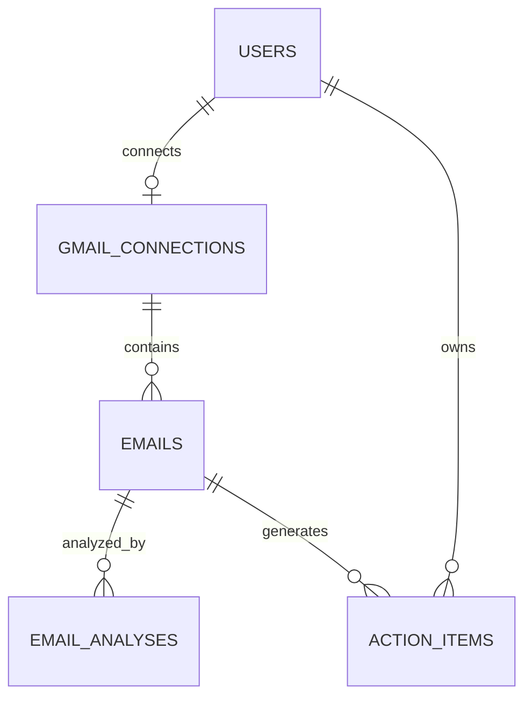

# Mailkind

## System Architecture Document

**Version:** 1.0  
**Status:** Proposed  
**Architecture:** Modular Monolith  
**Related Document:** `PRD.md`

### Implementation Status — November 16, 2026

The initial scaffold is implemented; this document otherwise describes the target
architecture. React/Vite/TypeScript/Tailwind and Flask/Pydantic settings are configured
with dependency lockfiles and environment examples. `/api/health`, the local Vite API
proxy, and CORS configuration have been verified. Phase 1 is complete: application-wide
JSON HTTP error handling preserves status codes and protocol headers, and uncaught
exceptions return generic 500 JSON outside debug/testing propagation. The 12 foundation
tests and the Phase 2 schema/service/endpoint tests pass. The frontend now has the global
design/motion system and a responsive homepage with a fictional, browser-local inbox
preview. Filtering, email details, copy/review controls, mobile navigation, and FAQs
demonstrate the UI without making provider or backend requests.

SQLAlchemy/psycopg, Alembic, and Google OAuth/Gmail client factories are configured.
Phase 2 adds strict email input/output schemas, a versioned prompt, OpenRouter analysis,
bounded service retries, and an opt-in `/api/dev/analyze` endpoint. Phase 2 is complete:
the fixed free ERNIE model passed all eight synthetic cases and manual review. Findings are recorded
in [Phase 2 guide](TASKS.md#phase-2-analysis-and-testing-guide) and `TASKS.md`.
Phase 3 adds the five SQLAlchemy models, ownership-scoped repositories, migration `0001`,
and opt-in rollback-only Neon tests. Migration `0001` is applied; all 88 tests pass.
See `TASKS.md` for live migration verification.
Phase 4 implements Google OAuth with state/PKCE, Fernet-encrypted refresh tokens,
signed application sessions, CSRF-protected disconnection, read-only Gmail retrieval,
and homepage connection controls. Google calls are mocked in routine tests; live consent,
token refresh, one-message reading, disconnection, and reauthorization passed. No real
email content was stored or sent to AI in Phase 4. Phase 5 implements bounded sync,
sequential per-email processing, email APIs, and homepage progress controls. Synthetic
live acceptance passed for two messages and repeat sync; dashboard features and deployment
remain later work.

Phase 6 introduces a stable QueryClientProvider, shared typed API/error/CSRF handling,
account-scoped email query keys, memory-only caching, and shared live UI primitives. Auth,
counts, and mutations use reusable hooks; batch progress and dialogs remain local state.
Automatic retries and offline mutation replay are disabled. Logout and identity changes
cancel private reads and clear private caches; temporary failures retain cached counts.
The existing API/schema and fictional demo are unchanged. 37 mocked frontend tests pass;
manual browser review remains pending because computer-use could not verify the browser URL.

Git is initialized on `main` and connected to the personal GitHub repository with a
repository-local personal SSH key. See `TASKS.md`
for detailed progress and `README.md` for current commands and configuration.

---

## 1. Architecture Overview

Mailkind is a full-stack AI-powered application consisting of a React frontend, Flask backend, PostgreSQL database, Gmail API integration, and an AI model accessed through OpenRouter.

The application connects to Gmail, retrieves messages, analyzes their contents using an LLM, stores the results, and displays actionable insights through a dashboard.

### Architectural Principles

- **Separation of Concerns:** Frontend, backend, AI processing, and data persistence have distinct responsibilities.
- **Modularity:** External integrations are isolated into reusable services.
- **Single-Agent Approach:** Use one AI analysis component rather than multiple specialized agents.
- **Human-in-the-Loop:** Sensitive actions require explicit user approval.
- **Security First:** Authentication credentials and API keys remain on the backend.
- **Cost Efficiency:** Minimize API calls and use free-tier services where practical.
- **Extensibility:** Support future AI tools, integrations, and background processing without major architectural changes.

---

## 2. Technology Stack

| Layer             | Technology        | Purpose                            |
| ----------------- | ----------------- | ---------------------------------- |
| Frontend          | React             | User interface                     |
| Frontend Language | TypeScript        | Type-safe development              |
| Build Tool        | Vite              | Frontend tooling                   |
| Styling           | Tailwind CSS      | UI styling                         |
| Backend           | Python            | Server-side application logic      |
| Backend Framework | Flask             | REST API                           |
| API Validation    | Pydantic          | Request and AI response validation |
| AI SDK            | OpenAI Python SDK | LLM communication                  |
| AI Provider       | OpenRouter        | Access to free AI models           |
| Email Integration | Gmail API         | Email retrieval                    |
| Authentication    | Google OAuth 2.0  | Gmail authorization                |
| Database          | Neon PostgreSQL   | Persistent storage                 |
| ORM               | SQLAlchemy        | Database operations                |
| Migrations        | Alembic           | Database schema versioning         |
| Frontend Hosting  | Vercel            | Frontend deployment                |
| Backend Hosting   | Vercel            | Flask deployment                   |
| Version Control   | Git + GitHub      | Source control                     |

### Technology Decisions

**React + Vite**

Provides a lightweight frontend independent of the Python backend.

**Flask**

A minimal Python web framework suitable for building REST APIs and integrating AI services without unnecessary complexity.

**OpenAI Python SDK + OpenRouter**

The OpenAI SDK communicates with OpenRouter through its OpenAI-compatible API.

This allows different supported models to be selected through configuration without rewriting the core AI service.

**Neon PostgreSQL**

Provides a managed PostgreSQL database suitable for storing users, Gmail connections, email metadata, AI analyses, and action items.

**SQLAlchemy + Alembic**

SQLAlchemy manages database access, while Alembic manages schema migrations.

---

## 3. High-Level System Architecture

```text
                  USER
                    |
                    v
            +----------------+
            | React Frontend |
            | TypeScript     |
            +----------------+
                    |
                HTTPS/JSON
                    |
                    v
            +----------------+
            | Flask REST API |
            +----------------+
                    |
         +----------+----------+
         |          |          |
         v          v          v
   +-----------+ +----------+ +-----------+
   | Gmail     | | AI       | | Database  |
   | Service   | | Service  | | Service   |
   +-----------+ +----------+ +-----------+
         |          |          |
         v          v          v
   +-----------+ +----------+ +-----------+
   | Gmail API | |OpenRouter| | Neon      |
   | Google    | | LLM      | | PostgreSQL|
   +-----------+ +----------+ +-----------+
```

### Component Responsibilities

#### Frontend

- Display the Gmail connection interface.
- Display synchronized and analyzed emails.
- Show priorities, categories, and suggested actions.
- Display editable AI-generated reply text.
- Manage email filters and action statuses.
- Communicate with the Flask backend.

#### Backend

- Handle OAuth authentication and sessions.
- Retrieve emails through Gmail API.
- Normalize incoming email data.
- Coordinate AI analysis requests.
- Validate AI-generated responses.
- Store and retrieve application data.
- Enforce security and authorization rules.
- Return structured JSON responses.

#### AI Service

- Construct prompts.
- Communicate with OpenRouter.
- Summarize email contents.
- Classify emails.
- Extract deadlines and requested actions.
- Identify whether replies are necessary.
- Generate suggested responses.
- Validate model output before returning results.

#### Database

- Store user information.
- Store encrypted Gmail credentials.
- Store synchronized email records.
- Store AI-generated analyses.
- Store action-tracking information.
- Prevent duplicate records.

---

## 4. Project Directory Structure

The application will use a monorepo containing separate frontend and backend applications.

```text
personal-inbox-triage-agent/
|
|-- frontend/
|   |-- public/
|   |-- src/
|   |   |-- components/
|   |   |-- pages/
|   |   |-- hooks/
|   |   |-- services/
|   |   |-- types/
|   |   |-- utils/
|   |   |-- App.tsx
|   |   |-- main.tsx
|   |-- package.json
|   |-- vite.config.ts
|   |-- .env.example
|
|-- backend/
|   |-- app/
|   |   |-- __init__.py
|   |   |-- config.py
|   |   |
|   |   |-- routes/
|   |   |   |-- auth.py
|   |   |   |-- emails.py
|   |   |   |-- analyses.py
|   |   |   |-- actions.py
|   |   |
|   |   |-- services/
|   |   |   |-- gmail_service.py
|   |   |   |-- ai_service.py
|   |   |   |-- email_service.py
|   |   |   |-- auth_service.py
|   |   |
|   |   |-- models/
|   |   |   |-- user.py
|   |   |   |-- gmail_connection.py
|   |   |   |-- email.py
|   |   |   |-- email_analysis.py
|   |   |   |-- action_item.py
|   |   |
|   |   |-- schemas/
|   |   |   |-- email_schema.py
|   |   |   |-- analysis_schema.py
|   |   |
|   |   |-- repositories/
|   |   |-- utils/
|   |
|   |-- migrations/
|   |-- tests/
|   |-- requirements.txt
|   |-- run.py
|   |-- .env.example
|
|-- docs/
|   |-- PRD.md
|   |-- ARCHITECTURE.md
|   |-- CODING_GUIDELINES.md
|   |-- DESIGN_SYSTEM.md
|   |-- TASKS.md
|
|-- .gitignore
|-- README.md
```

### Folder Responsibilities

| Folder               | Responsibility                   |
| -------------------- | -------------------------------- |
| `components/`        | Reusable React components        |
| `pages/`             | Application pages                |
| `hooks/`             | React custom hooks               |
| `frontend/services/` | Backend API communication        |
| `routes/`            | Flask HTTP endpoints             |
| `backend/services/`  | Business logic and integrations  |
| `models/`            | SQLAlchemy database entities     |
| `schemas/`           | Pydantic validation schemas      |
| `repositories/`      | Database queries and persistence |
| `utils/`             | Shared helper functions          |
| `migrations/`        | Database schema migrations       |
| `tests/`             | Automated backend tests          |

The structure is a proposed starting point and may evolve as features are implemented.

---

## 5. Database Design

### 5.1 Database Overview

The application uses Neon PostgreSQL.

The initial database contains five core tables:

1. `users`
2. `gmail_connections`
3. `emails`
4. `email_analyses`
5. `action_items`

The schema supports one Gmail connection per user during the MVP while remaining extensible for multiple accounts.

### 5.2 Entity Relationship Diagram



### 5.3 Table: users

Stores application user information.

| Column       | Type         | Constraints          |
| ------------ | ------------ | -------------------- |
| id           | UUID         | Primary Key          |
| email        | VARCHAR(255) | Unique, Not Null     |
| display_name | VARCHAR(255) | Nullable             |
| timezone     | VARCHAR(100) | Default: Asia/Manila |
| created_at   | TIMESTAMPTZ  | Not Null             |
| updated_at   | TIMESTAMPTZ  | Not Null             |

**Purpose:**

Identify the application user and associate their Gmail data, analyses, and actions with their account.

### 5.4 Table: gmail_connections

Stores Gmail account authorization details.

| Column                  | Type         | Constraints         |
| ----------------------- | ------------ | ------------------- |
| id                      | UUID         | Primary Key         |
| user_id                 | UUID         | Foreign Key, Unique |
| gmail_address           | VARCHAR(255) | Not Null            |
| encrypted_refresh_token | TEXT         | Nullable            |
| scopes                  | JSONB        | Not Null            |
| status                  | VARCHAR(30)  | Not Null            |
| connected_at            | TIMESTAMPTZ  | Not Null            |
| updated_at              | TIMESTAMPTZ  | Not Null            |

**Relationships:**

- One user has zero or one Gmail connection in the MVP.
- One Gmail connection can have many emails.

**Notes:**

- Refresh tokens must be encrypted at rest.
- Access tokens may be short-lived and do not need persistent storage.
- If Google does not issue a refresh token, the application must handle reauthorization.
- Disconnecting the account prevents future synchronization.

### 5.5 Table: emails

Stores synchronized Gmail messages.

| Column              | Type         | Constraints           |
| ------------------- | ------------ | --------------------- |
| id                  | UUID         | Primary Key           |
| gmail_connection_id | UUID         | Foreign Key, Not Null |
| gmail_message_id    | VARCHAR(255) | Not Null              |
| gmail_thread_id     | VARCHAR(255) | Not Null              |
| sender              | TEXT         | Nullable              |
| subject             | TEXT         | Nullable              |
| body                | TEXT         | Nullable              |
| received_at         | TIMESTAMPTZ  | Nullable              |
| created_at          | TIMESTAMPTZ  | Not Null              |

**Unique Constraint:**

`(gmail_connection_id, gmail_message_id)`

**Purpose:**

Store the source messages used by the AI analyzer and prevent duplicate synchronization.

**Notes:**

- Store only data required by the application.
- Email body retention must be configurable or governed by a defined retention policy.
- HTML content should be normalized to safe readable text before AI analysis.
- Gmail message IDs and thread IDs must remain separate.

### 5.6 Table: email_analyses

Stores validated AI analysis results.

| Column           | Type         | Constraints           |
| ---------------- | ------------ | --------------------- |
| id               | UUID         | Primary Key           |
| email_id         | UUID         | Foreign Key, Not Null |
| summary          | TEXT         | Nullable              |
| category         | VARCHAR(30)  | Nullable              |
| priority         | VARCHAR(10)  | Nullable              |
| deadline         | DATE         | Nullable              |
| deadline_text    | TEXT         | Nullable              |
| requested_action | TEXT         | Nullable              |
| suggested_action | TEXT         | Nullable              |
| reply_needed     | BOOLEAN      | Nullable              |
| draft_reply      | TEXT         | Nullable              |
| model_identifier | VARCHAR(255) | Nullable              |
| status           | VARCHAR(30)  | Not Null              |
| error_code       | VARCHAR(100) | Nullable              |
| created_at       | TIMESTAMPTZ  | Not Null              |

**Analysis Statuses:**

- `pending`
- `processing`
- `completed`
- `failed`

**Purpose:**

Store the AI's interpretation of each email.

**Design Decision:**

One email can have multiple analysis records.

This allows future reanalysis using improved prompts or different AI models without overwriting historical results.

The dashboard should use the latest successfully completed analysis by default.

### 5.7 Table: action_items

Stores actions associated with emails.

| Column      | Type        | Constraints           |
| ----------- | ----------- | --------------------- |
| id          | UUID        | Primary Key           |
| user_id     | UUID        | Foreign Key, Not Null |
| email_id    | UUID        | Foreign Key, Not Null |
| description | TEXT        | Not Null              |
| due_date    | DATE        | Nullable              |
| status      | VARCHAR(30) | Not Null              |
| created_at  | TIMESTAMPTZ | Not Null              |
| updated_at  | TIMESTAMPTZ | Not Null              |

**Action Statuses:**

- `pending`
- `in_progress`
- `completed`
- `dismissed`

**Purpose:**

Track tasks that the user chooses to manage after reviewing AI recommendations.

AI-generated suggestions should not automatically become confirmed user tasks.

### Phase 5 operation leases

Migration `0002` adds `operation_id` (nullable UUID) and `operation_expires_at` (nullable
TIMESTAMPTZ) to gmail_connections. An atomic two-minute lease permits only one sync or
analysis request per connection. Short row locks guard writes against disconnect; network
calls never hold those locks. Owners release only their own leases. New operations recover
abandoned processing attempts after expiry. A unique partial index on email_analyses(email_id)
for pending/processing statuses prevents duplicate active attempts. Historical results remain.

The sync service imports at most 20 matching inbox messages under a 60-second fetch budget.
The frontend then calls the analysis endpoint sequentially. Existing normalization, AI
validation/retries, transactions, authentication, and CSRF helpers are reused. An optional
GMAIL_SYNC_QUERY restricts imports for synthetic verification; provider calls are mocked in
automated tests. List filters use the latest completed classification, while processing status
uses the latest attempt. Pending work and failed retries are resumable without a job queue.

### 5.8 Database Design Rules

Phase 3 implementation uses database uniqueness for user email, connection ownership,
and `(gmail_connection_id, gmail_message_id)`. Email synchronization inserts with
`ON CONFLICT DO NOTHING`, preserving existing records. User emails are normalized to
lowercase by the repository. Status, category, and priority constraints enforce the
documented analysis/action values. Composite indexes cover email received dates,
analysis history, and user action status/due dates; action email references are indexed.

Foreign keys cascade deletions. Disconnecting Gmail retains history and clears stored
credentials. Repositories take an explicit session and enforce ownership through the
connection/email relationships, including checking action email ownership on creation.
Services own commits and rollbacks. Refresh-token encryption remains a Phase 4 service
responsibility, implemented by the auth service; the repository accepts only caller-encrypted
token values by contract. Conditional credential updates compare prior ciphertext and
connected status so late refreshes cannot restore a disconnected connection.

Revision `0001` is a frozen schema snapshot. Tests replay it offline against model metadata.
Explicit `--run-db-tests` tests use the configured Neon pooled URL, with transaction
rollback and savepoints; routine pytest runs do not connect. No local test database is
required. Migration downgrades are rendered offline, never executed against Neon by tests.

- Use UUIDs for primary keys.
- Store timestamps in UTC using `TIMESTAMPTZ`.
- Convert timestamps to the user's timezone when displaying them.
- Define foreign key constraints.
- Index frequently queried fields such as priority, status, and dates where appropriate.
- Enforce ownership checks in backend queries.
- Avoid saving duplicate Gmail messages.
- Keep AI analysis history separate from source email records.
- Use Alembic for schema changes.
- Do not store plaintext OAuth refresh tokens.

---

## 6. Gmail Integration Architecture

### 6.1 Authentication Flow

The application uses Google OAuth 2.0.

```text
User
  |
  v
React: Connect Gmail
  |
  v
Flask: Start OAuth
  |
  v
Google Authorization Screen
  |
  v
User Grants Permission
  |
  v
Flask: OAuth Callback
  |
  v
Validate State + Exchange Code
  |
  v
Create Authenticated Session
  |
  v
Store Encrypted Refresh Token
  |
  v
Redirect to React Dashboard
```

### 6.2 Gmail Permissions

Initial OAuth scope:

`https://www.googleapis.com/auth/gmail.readonly`

This allows the application to retrieve Gmail messages without modifying them.

The `gmail.readonly` scope is classified by Google as restricted. Public deployment may require additional verification and security assessment.

For the MVP, use an authorized personal Google account in a testing configuration.

### 6.3 Email Retrieval

The Gmail service will use the following Gmail API operations:

| Gmail API             | Purpose                            |
| --------------------- | ---------------------------------- |
| `users.messages.list` | Retrieve message IDs               |
| `users.messages.get`  | Retrieve message details           |
| `users.getProfile`    | Retrieve Gmail account information |

**Initial Synchronization:**

- Retrieve up to 20 recent inbox messages.
- Fetch details for each message.
- Normalize the email content.
- Store new messages.
- Analyze the messages.

**Subsequent Synchronization:**

- Retrieve recent messages.
- Compare Gmail message IDs with stored records.
- Skip already synchronized messages.
- Process only new messages.

The MVP uses manual synchronization. Scheduled synchronization will be implemented later.

### 6.4 Email Normalization

Gmail messages may contain:

- Plain text.
- HTML.
- Multipart MIME content.
- Attachments.
- Encoded payloads.

The email service must convert supported message bodies into consistent text suitable for AI analysis.

**MVP Rules:**

- Prefer the readable `text/plain` body.
- Convert HTML to readable text when necessary.
- Do not process attachment contents.
- Preserve sender, subject, received timestamp, and Gmail identifiers.
- Apply reasonable text-length limits before sending content to the model.

---

## 7. AI Processing Architecture

### 7.1 AI Provider Configuration

The backend uses the OpenAI Python SDK with OpenRouter.

```python
from openai import OpenAI

client = OpenAI(
    base_url="https://openrouter.ai/api/v1",
    api_key=OPENROUTER_API_KEY
)
```

The selected model will be configured through environment variables.

The initial model must:

- Be available through OpenRouter's free tier.
- Support text-based email analysis.
- Follow structured-output instructions reliably.
- Be evaluated before processing real email content.

The selected model is `baidu/ernie-5.5-flash-preview:free`, which passed the Phase 2
synthetic evaluation and manual review. Initial `openrouter/free` evaluations exposed
quality variability. Each response records the actual model. `OPENROUTER_MODEL` remains
configurable, with no automatic model fallback. GPT-5.6 Sol was considered but is paid.
See [Phase 2 guide](TASKS.md#phase-2-analysis-and-testing-guide) for findings, limits, and privacy considerations.

### 7.2 AI Analysis Pipeline

```text
Gmail Message
      |
      v
Email Normalization
      |
      v
Input Preparation
      |
      v
Prompt Construction
      |
      v
OpenRouter LLM Request
      |
      v
Parse Model Response
      |
      v
Pydantic Validation
      |
  +---+---+
  |       |
Valid   Invalid
  |       |
  v       v
Save    Limited Retry
Result    |
  |       v
  |     Record Failure
  v
React Dashboard
```

### 7.3 AI Input

The AI receives:

- Email subject.
- Email sender, when available.
- Normalized email body.
- Email received timestamp.
- User timezone.

The email content must be treated as data, not trusted instructions.

### 7.4 AI Output Schema

The initial response follows this structure:

```json
{
  "summary": "The sender requests a progress report.",
  "category": "Work",
  "priority": "High",
  "deadline": null,
  "deadline_text": "Friday",
  "requested_action": "Submit the progress report.",
  "suggested_action": "Prepare and review the report.",
  "reply_needed": true,
  "draft_reply": "Hi, I'll review the request and follow up shortly."
}
```

### 7.5 Validation Strategy

Pydantic will validate AI-generated responses.

Validation must check:

- Required fields.
- Allowed category values.
- Allowed priority values.
- Boolean fields.
- Nullable values.
- Date formatting.
- Response structure.

Schema validation ensures correct formatting but does not guarantee factual accuracy.

Model outputs should also be tested against a dataset of example emails with expected classifications.

### 7.6 Error Handling

Possible failures include:

- Rate limiting.
- Provider downtime.
- Invalid JSON.
- Schema validation errors.
- Request timeouts.
- Missing model responses.

**Strategy:**

Phase 2 currently uses a 30-second timeout per attempt and at most two attempts overall,
with SDK retries disabled. Retry connection failures, timeouts, provider 5xx errors,
and invalid output once; do not retry rate limits, credential failures, or refusals.
The development endpoint is registered only with `ENABLE_DEV_ANALYSIS=true` (default
false), accepts synthetic plain-text emails, and never persists results. Failure-state
records and manual reanalysis below belong to the later persistence pipeline.

1. Use defined request timeouts.
2. Retry only recoverable failures.
3. Limit retry attempts.
4. Record failed analysis status.
5. Preserve successfully synchronized email data.
6. Allow manual reanalysis.

### 7.7 Agent Design

The MVP uses a single LLM analysis component.

It is initially a structured AI workflow, not an autonomous multi-step agent.

Future versions may introduce tool calling for:

- Retrieving previous email context.
- Looking up user preferences.
- Checking existing action items.
- Checking calendar availability.
- Creating Gmail drafts with approval.

Tool execution must always be controlled by backend permissions.

---

## 8. Backend API Design

### 8.1 API Convention

Base path:

`/api`

All API requests and responses use JSON except OAuth redirects.

User-specific endpoints must require an authenticated session.

### 8.2 Authentication Endpoints

| Method | Endpoint                    | Description                |
| ------ | --------------------------- | -------------------------- |
| GET    | `/api/auth/google`          | Start OAuth authentication |
| GET    | `/api/auth/google/callback` | Process OAuth callback     |
| GET    | `/api/auth/status`          | Get connection status      |
| POST   | `/api/auth/disconnect`      | Disconnect Gmail           |

### 8.3 Email Endpoints

| Method | Endpoint                    | Description                       |
| ------ | --------------------------- | --------------------------------- |
| GET    | `/api/emails`               | List synchronized emails          |
| GET    | `/api/emails/{id}`          | Get email details                 |
| POST   | `/api/emails/sync`          | Synchronize recent Gmail messages |
| POST   | `/api/emails/{id}/analyze`  | Analyze or reanalyze an email     |
| GET    | `/api/emails/{id}/analyses` | Get analysis history              |

### 8.4 Action Endpoints

| Method | Endpoint            | Description                      |
| ------ | ------------------- | -------------------------------- |
| GET    | `/api/actions`      | List action items                |
| POST   | `/api/actions`      | Create user-approved action item |
| PATCH  | `/api/actions/{id}` | Update action status             |

### 8.5 System Endpoints

| Method | Endpoint      | Description      |
| ------ | ------------- | ---------------- |
| GET    | `/api/health` | API health check |

Local Phase 2 only: `POST /api/dev/analyze` accepts subject, optional sender, body,
offset-aware received_at, and IANA timezone. Its successful data object contains analysis,
actual model, prompt_version, and nullable token usage. It is absent unless explicitly
enabled. See [Phase 2 guide](TASKS.md#phase-2-analysis-and-testing-guide) for validation limits and error status codes.

### 8.6 Standard API Response

Successful response example:

```json
{
  "success": true,
  "data": {
    "message": "Email analysis completed."
  }
}
```

Error response example:

```json
{
  "success": false,
  "error": {
    "code": "AI_RATE_LIMITED",
    "message": "The AI provider is temporarily unavailable due to rate limits."
  }
}
```

Actual HTTP status codes must reflect the result.

---

## 9. Authentication and Security

### 9.1 Session Management

Phase 4 uses Flask's signed `mailkind_session` cookie: HttpOnly, SameSite=Lax,
eight-hour lifetime, Secure when configured for HTTPS, and no automatic sliding refresh.
The cookie contains user ID, CSRF token, and temporary state/PKCE values, never access
or refresh tokens. OAuth state expires after ten minutes and is cleared on callback.
Successful authorization clears prior session values and creates a fresh authenticated
session. `/api/auth/status` returns only configuration/connection status, user ID/email,
and the authenticated session's CSRF token. Disconnect requires `X-CSRF-Token`.

The Google profile supplies the Gmail account identity with the existing read-only scope.
Changing accounts requires disconnection. Refresh tokens are encrypted with Fernet;
access tokens exist only during server-side requests. Refresh failures from revoked
grants mark the connection `reauthorization_required`; transient failures preserve it.
Disconnect removes credentials locally before attempting remote revocation, clears the
current cookie, and preserves email/analysis/action history. Remote failure is reported.

The Gmail reader fetches up to 20 inbox IDs and full details, normalizes inline MIME text,
and never fetches attachments or remote HTML resources. Bodies are bounded to 256 KB
decoded across at most 200 MIME parts and depth 20, then limited to 20,000 characters.
HTML is converted to readable text, not rendered. The explicit development smoke command
reads at most one message and prints only counts. No real emails are persisted or sent
to AI in Phase 4. Invalid or oversized messages return safe errors.

The local Werkzeug filter removes OAuth callback query strings. Hosted access logging
must also omit those query strings. Missing/invalid auth configuration keeps health and
the sample homepage available. Live setup instructions and acceptance are in `TASKS.md`.

The backend manages authenticated user sessions after successful Google OAuth authorization.

Recommended approach:

- Use secure, HttpOnly session cookies.
- Enable the `Secure` attribute in production.
- Use an appropriate `SameSite` policy.
- Protect state-changing endpoints against CSRF.
- Restrict CORS to trusted frontend origins.
- Validate user identity and ownership on every protected request.

### 9.2 Token Management

- Store refresh tokens encrypted.
- Keep encryption keys in environment variables.
- Never expose OAuth credentials to the frontend.
- Never log access or refresh tokens.
- Handle revoked and expired tokens.
- Delete stored credentials when disconnecting the account.

### 9.3 AI Security

- Treat email bodies as untrusted input.
- Ignore instructions embedded in emails that attempt to control the agent.
- Validate AI outputs before storing or displaying them.
- Keep all external write operations behind backend authorization.
- Never assume a model-generated instruction grants permission.

### 9.4 Data Privacy

- Minimize stored email content.
- Avoid logging message bodies.
- Review OpenRouter and model-provider data handling policies.
- Define an email retention and deletion policy before processing real Gmail data.
- Protect stored data using authenticated and authorized database access.
- Escape or sanitize displayed email content to prevent XSS.

---

## 10. Deployment Architecture

### 10.1 Initial Deployment

```text
          GitHub Repository
                 |
        +--------+--------+
        |                 |
        v                 v
  Vercel Frontend    Vercel Backend
    React/Vite         Flask API
        |                 |
        +--------+--------+
                 |
           External APIs
                 |
       +---------+---------+
       |         |         |
       v         v         v
     Gmail   OpenRouter   Neon
      API       AI       PostgreSQL
```

### 10.2 Frontend Deployment

Platform: **Vercel**

The React application is built using Vite and deployed as a static frontend.

### 10.3 Backend Deployment

Initial Platform: **Vercel**

The Flask application runs using Vercel's Python runtime.

**Considerations:**

- Serverless request duration limits.
- AI inference latency.
- Gmail synchronization batch size.
- Database connection management.
- Stateless backend execution.

Long-running processing may eventually require a separate backend worker.

### 10.4 Database Connection Strategy

Use Neon PostgreSQL connection strings.

**Pooled Connection:**

Used for regular application traffic, especially serverless requests.

**Direct Connection:**

Used for migrations and administrative operations requiring session-level database behavior.

Database credentials must remain server-side.

### 10.5 Environment Variables

#### Frontend

```env
VITE_API_BASE_URL=
```

#### Backend

```env
SECRET_KEY=
SESSION_COOKIE_SECURE=false

DATABASE_URL=
DIRECT_DATABASE_URL=

GOOGLE_CLIENT_ID=
GOOGLE_CLIENT_SECRET=
GOOGLE_REDIRECT_URI=

OPENROUTER_API_KEY=
OPENROUTER_MODEL=baidu/ernie-5.5-flash-preview:free
OPENROUTER_BASE_URL=https://openrouter.ai/api/v1
ENABLE_DEV_ANALYSIS=false

TOKEN_ENCRYPTION_KEY=

FRONTEND_URL=
```

Environment variables must not be committed to Git.

Use the Flask CLI's `--debug` option locally; `FLASK_ENV` was removed in Flask 2.3.
`SESSION_COOKIE_SECURE=false` is a local development value; secure cookies are required
for the planned production environment. Current examples are maintained in
`frontend/.env.example` and `backend/.env.example`.

Separate configurations should be maintained for local development and production.

---

## 11. Error Handling and Reliability

### Gmail API

- Handle expired credentials.
- Handle revoked permissions.
- Respect Google API rate limits.
- Prevent duplicate inserts.
- Preserve previously synchronized emails when retrieval fails.

### OpenRouter

- Handle unavailable models.
- Handle rate limits.
- Validate model output.
- Limit retries.
- Track failed analyses.

### Database

- Use transactions for related writes.
- Enforce unique constraints.
- Handle connection failures.
- Roll back failed transactions.
- Use migrations for schema changes.

### Frontend

- Display loading states.
- Show understandable error messages.
- Preserve existing results during temporary failures.
- Allow users to retry failed operations.

---

## 12. Performance and Cost Optimization

The initial architecture should prioritize low-cost operation.

### Optimization Strategies

1. Fetch only a limited number of recent emails.
2. Analyze only new or explicitly reanalyzed emails.
3. Store completed analyses for reuse.
4. Avoid unnecessary AI requests.
5. Set reasonable email content limits.
6. Use batch processing with controlled concurrency.
7. Use Neon connection pooling for serverless traffic.
8. Track AI request failures and provider rate limits.

### MVP Defaults

| Setting                 | Initial Value           |
| ----------------------- | ----------------------- |
| Initial email fetch     | 20 messages             |
| Synchronization         | Manual                  |
| AI model                | Configurable free model |
| AI concurrency          | 1 request at a time     |
| Retry attempts          | Maximum of 2            |
| Gmail accounts          | 1 per user              |
| Attachment processing   | Disabled                |
| Automated email sending | Disabled                |

These values are configurable and may be adjusted after testing.

For the initial deployment, synchronize emails in small, bounded batches to avoid exceeding serverless execution limits.

---

## 13. Testing Strategy

### Backend Testing

Use `pytest` to test:

- API endpoints.
- Authentication logic.
- Gmail response parsing.
- Database operations.
- Duplicate prevention.
- Authorization rules.
- AI response validation.

### AI Evaluation

Create representative email test cases covering:

- Important work requests.
- Production incidents.
- Financial reminders.
- Meetings.
- Promotional emails.
- Newsletters.
- Ambiguous deadlines.
- Emails requiring replies.
- Emails containing malicious instructions.

Measure:

- Category accuracy.
- Priority accuracy.
- Deadline extraction accuracy.
- Reply-needed accuracy.
- Structured-output success rate.
- Hallucination frequency.

Use mocked Gmail and OpenRouter responses for deterministic automated tests.

Live integration tests should be separate from unit tests.

---

## 14. Future Architecture Enhancements

The architecture should support the following without requiring a complete rewrite:

### Background Processing

Introduce a worker or job queue when scheduled synchronization and larger email batches become necessary.

### Scheduled Inbox Monitoring

Automatically retrieve and analyze new messages on a configured schedule.

### Daily Digest

Aggregate important messages and action items into a daily summary.

### Agent Tool Calling

Allow the AI to request approved tools for retrieving additional context.

### Personalization

Store user-defined rules for priority, preferred senders, and reply style.

### Gmail Write Integration

Introduce separately authorized Gmail scopes for creating drafts or performing approved actions.

### Multi-Account Support

Extend Gmail connections to support multiple accounts per user.

---

## 15. Architectural Decisions Summary

| Decision                 | Choice                                 |
| ------------------------ | -------------------------------------- |
| Application Architecture | Modular Monolith                       |
| Frontend                 | React + TypeScript + Vite              |
| Backend                  | Python + Flask                         |
| API Style                | REST                                   |
| Database                 | Neon PostgreSQL                        |
| ORM                      | SQLAlchemy                             |
| Migrations               | Alembic                                |
| AI Provider              | OpenRouter                             |
| AI SDK                   | OpenAI Python SDK                      |
| AI Design                | Single-Agent / Structured LLM Workflow |
| Gmail Integration        | Gmail API                              |
| Authentication           | Google OAuth 2.0                       |
| Gmail Permissions        | Read-only for MVP                      |
| AI Validation            | Pydantic                               |
| Frontend Deployment      | Vercel                                 |
| Backend Deployment       | Vercel, initially                      |
| Background Jobs          | Post-MVP                               |
| External Write Actions   | Explicit approval required             |

---

## 16. Architecture Goals

The architecture is considered successful when:

- [ ] React communicates securely with Flask.
- [ ] Google OAuth connects a Gmail account.
- [ ] Gmail messages can be retrieved and normalized.
- [ ] The AI service analyzes messages through OpenRouter.
- [ ] Pydantic validates AI-generated results.
- [x] SQLAlchemy persists application data in Neon (repositories verified with synthetic data).
- [ ] Duplicate Gmail messages are prevented.
- [ ] Users can view email analyses in the dashboard.
- [ ] Users can manage action statuses.
- [ ] Unauthorized access and external write operations are prevented.
- [ ] Errors are handled without losing existing records.
- [ ] The application can be deployed using the selected infrastructure.

---

## 17. References

- Gmail API: https://developers.google.com/workspace/gmail/api
- Google OAuth: https://developers.google.com/identity/protocols/oauth2
- OpenRouter: https://openrouter.ai/docs
- OpenAI Python SDK: https://github.com/openai/openai-python
- Flask: https://flask.palletsprojects.com/
- Pydantic: https://docs.pydantic.dev/
- SQLAlchemy: https://docs.sqlalchemy.org/
- Alembic: https://alembic.sqlalchemy.org/
- Neon: https://neon.com/docs
- Vercel Flask: https://vercel.com/docs/frameworks/backend/flask

---

**Document Version:** 1.0  
**Status:** Proposed Architecture  
**Next Step:** Complete Phase 6 manual review, then plan the Phase 7 dashboard;
see [Phase 2 guide](TASKS.md#phase-2-analysis-and-testing-guide) for current analysis behavior and evaluation limits.
